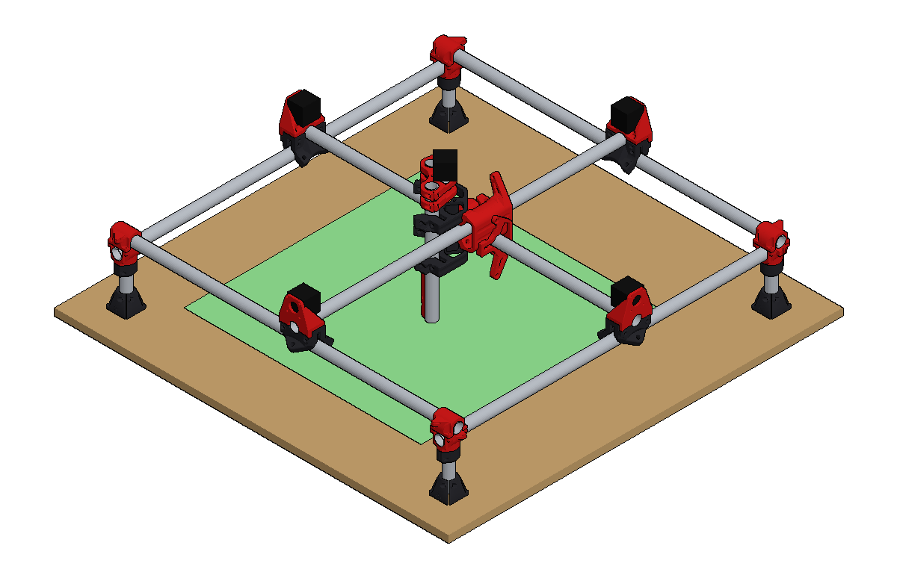

# MPCNC Burly (J / 25.4 mm) - Tertius model

Tertius project: `mpcnc_burly`. Edit `params.json` (rail length, leg, rail height, Z height, pose, colours), then recompile.
Built as a base for designing add-on parts, so the printed parts are V1's real geometry, not stand-ins.



- **Printed parts** are V1 Engineering's Burly J STLs ([thing:1671517](https://www.thingiverse.com/thing:1671517)),
  decimated by vertex clustering on a 0.35 mm grid and stored as `mesh_<part>.json`
  (int16 vertices at 0.02 mm, zlib + base64). V1's "M" (mirrored) parts are the same meshes reflected.
  The tool mount is the M4 version.
- **Measured on the machine:** 865 mm rails (corner to corner), 90 mm legs, and the lower rails'
  underside 117 mm above the table. The model builds the frame up from that rail height, which leaves
  the leg bottoms 9.9 mm above the table inside the feet (V1 sets the legs with a block).
- **Z rails** measured at 271 mm (V1's formula: usable height 81 + 190). All six X/Y tubes (rails and
  gantries) are the rail length, per V1's Burly cut list (`burly_calc.py`).
- **Belt anchors** (add-on, see credits): an upper anchor on each Top Corner and a lower anchor on
  each Bottom Corner, hooked over the corner's zip-tie bracket with the box running inboard along
  the rail. Fitted by mesh search: the bracket sits in the anchor's pocket with only a few touching
  points. The belt clips that slide into the anchors are not drawn.
- **Drag chain mounts** (add-on, see credits) on both X-rail rollers and the left Y-rail roller: on
  the roller's two lower bearing bolts (30 deg from vertical, through the inboard arm), outside the
  bearings, so the chain face points down at the table under the rail. Clear of the roller and rail.
  The 10 x 15 chain itself is not drawn.
- **Steppers, leadscrew, coupler and T8 nut** are simple stand-ins. Bolts, bearings and belts are not drawn.
  Neither is a spindle; the tool mount is the last part on the Z axis.

## How each part is placed

V1 publishes no assembly, so every part was located from its own geometry (tube seats, bearing
bolt holes and mating faces measured from the STLs), then checked against V1's renders and
assembly photos (docs.v1e.com, Burly section):

| Part | Located by |
|---|---|
| Foot, Leg | leg clamped in the foot bore, at the height the measured rail height gives |
| Lock Corner | cup on the leg top; the leg stops on its 7 mm floor |
| Bottom Corner | back face glued to the lock floor, lock screw on the leg axis; lower (Y) rail in its U |
| Spacer Corner | saddles on both rails: sets the rail stack to 27.5 mm |
| Top Corner | upper (X) rail in its U; its flange sits 1.5 mm above the bottom's (V1's "2 mm gap") |
| Roller | two bearings (M8 at Xp 113.88) ride the top of the rail; gantry tube in its saddle 37.9 mm above the rail |
| RollerMount | its bore on the gantry tube, its two screws in the roller's holes; NEMA17 on its 6 mm plate |
| XYZ (x2) | T8 nut hole on the XY stems' 10 mm hole (the leadscrew goes through both), centre-back hole over the stems' bolt hole 16.5 mm behind it; mid-planes level with the XY ears (tube -46.5 / +74); front toward the 0,0 corner |
| Gantry Spacer (x2) | at the XYZ centre-back hole, between each XYZ flange and the middle |
| XY (x2) | bolt B through each stem, which puts each gantry tube 35.4 mm from the bolt; the X-gantry XY upside down |
| Z Motor, Z Lower | on the Z rails, leadscrew 24.18 mm in front of the rail line; Z Motor flush with the rail tops |
| Tool Mount | rail cups on the Z rails, bottom flush with the rail bottoms (its screws land 22.5 and 97.5 mm up) |
| Nut Trap (x2) | inside the Z rails, nuts at 22.5 and 97.5 mm |

 Known overlap: the XY ear tabs press about 1 mm (at most about 5 mm) into the edges of the XYZ plates;
flipping the plates doesn't change it, and with both holes aligned the plates can't move. Less certain: the gap between Z Motor and Z Lower (set by your coupler, `z_mount_gap` = 10 mm), and the
spin of the gantry spacers about bolt B.

## Findings (865 mm rails, 90 mm legs, 271 mm Z rails, lower rails 117 mm up)

- **Heights:** leg bottom 9.9, lock top 106.9, Y rails 129.7 (underside 117), X rails 157.2,
  X gantry 167.6, Y gantry 195.1, top of the middle 252.1 mm above the table.
- **Travel:** the gantries move 592 mm each way before the rollers meet the corners or the middle
  meets the rollers (bounding boxes, so a little conservative), against V1's 601 mm usable.
  The tool sits 66 mm left of and in front of the gantry crossing.
- **Z:** the Z axis bottoms out with Z Lower on the T8 nut while the Z rail bottoms (and the tool
  mount's bottom edge) are still 24.6 mm above the table. The 90 mm legs are 22 mm longer than V1's
  68 mm for 271 mm Z rails; the 10 mm Z Motor-Z Lower gap is assumed, and a smaller gap lowers this.

## Cut list

```
MPCNC Burly J, as built
  3 x x_rail     865.0 mm
  3 x y_rail     865.0 mm
  2 x z_rail     271.0 mm
  4 x leg         90.0 mm
leadscrew     157 mm (T8, V1's usable + 76)
usable area   601 x 601 x 81 mm (V1's figures for these rails)
```

## Licence and attribution

The printed-part meshes are derived from **Mostly Printed CNC "MPCNC" BURLY J-25.4mm** by
[V1 Engineering Inc](https://www.v1engineering.com/) (Allted on Thingiverse,
[thing:1671517](https://www.thingiverse.com/thing:1671517)), licensed under
[CC BY-NC-SA 4.0](https://creativecommons.org/licenses/by-nc-sa/4.0/).

Changes from the originals: the STLs were decimated (0.35 mm vertex clustering), quantised to
0.02 mm and repacked as `mesh_<part>.json`, and placed into an assembly by `design.py`. The cut list
in `burly_calc.py` comes from V1's documentation.

The belt anchors (`mesh_belt_anchor*.json`) are derived from **MPCNC Belt Mount/Tensioner** by
DodgeDerek ([thing:1833934](https://www.thingiverse.com/thing:1833934)), licensed under
[CC BY-NC](https://creativecommons.org/licenses/by-nc/4.0/); decimated and placed the same way.

The drag chain mounts (`mesh_drag_chain_mount.json`) are derived from **MPCNC drag chain / cable
carrier for XY-axis** by willnewton ([thing:1272581](https://www.thingiverse.com/thing:1272581)),
licensed under [CC BY-NC](https://creativecommons.org/licenses/by-nc/4.0/); decimated and placed the
same way.

As required by the ShareAlike term, this whole repository is released under the same licence,
**CC BY-NC-SA 4.0** (see `LICENSE`). This is a personal model of one machine; it is not made or
endorsed by V1 Engineering. Don't sell parts printed from these files. V1 asks that its designs
and the parts they make not be sold. Get the real parts from V1 Engineering's own downloads, not from
these decimated meshes.
